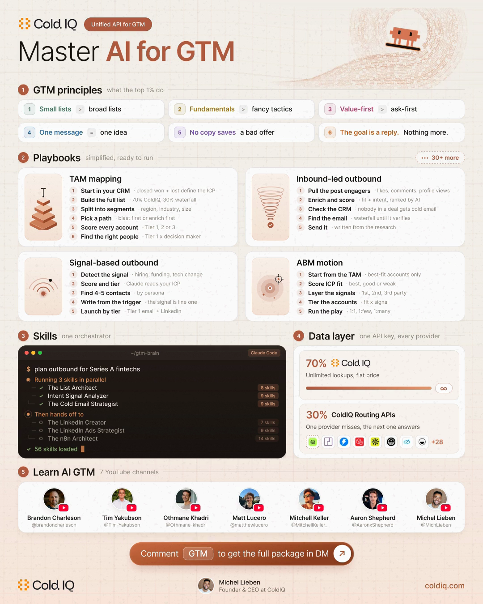

# Master AI for GTM

We ran outbound for 300+ B2B clients as an agency.

Then we turned everything we learned into repeatable skills and playbooks for AI agents like Claude Code, Codex or Grok Bot.

This repo is that kit.

## Get started in 2 minutes

1. Clone this repo and open it in Claude Code (or Codex).
2. Copy the skills into `.claude/skills/` (see [skills/](skills/)).
3. Connect the ColdIQ MCP so every skill runs on live data: contacts, emails, phones, signals, ads, in one API key.
   **[Get your ColdIQ access](https://login.coldiq.com/sign-up?utm_source=github&utm_medium=repo&utm_campaign=master-ai-for-gtm)**

## What's inside

| | |
|---|---|
| [**36 playbooks**](playbooks/) | Our favorite campaigns to run inside the terminal, from the signal to the booked meeting. |
| [**GTM principles**](gtm-principles.md) | The rules behind every campaign we run. |
| [**List building + signals**](skills/01-list-building-and-signals/) | Your ICP, the right people, who's hiring, raising or switching jobs. |
| [**Copywriting**](skills/02-copywriting/) | Cold emails and follow-ups written from the signal. |
| [**LinkedIn content**](skills/03-linkedin-content/) | Hooks, posts and formats that turn expertise into pipeline. |
| [**LinkedIn ads**](skills/04-linkedin-ads/) | Audiences, creatives and bidding, synced with your outbound. |
| [**Analytics**](skills/05-analytics/) | Why a campaign isn't getting replies, and the copy that wins. |
| [**Automation**](skills/06-automation/) | The whole system on a schedule with n8n. |
| [**Learn**](learn.md) | The best YouTube channels to learn agentic GTM & Claude Code. |

---

Built by [ColdIQ](https://coldiq.com?utm_source=github&utm_medium=repo&utm_campaign=master-ai-for-gtm), the Unified API for GTM. More skills on [coldiq.com/skills](https://coldiq.com/skills?utm_source=github&utm_medium=repo&utm_campaign=master-ai-for-gtm).

Skills in `skills/` include work from the ColdIQ GTM Skills repo and [gtm-flywheel](https://github.com/kenny589/gtm-flywheel) (MIT).
