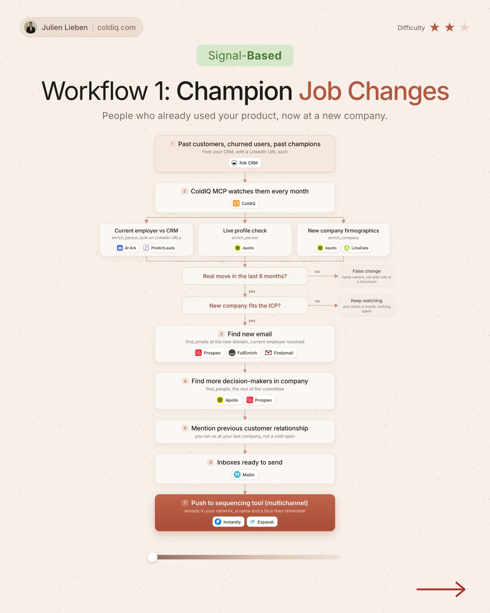

# 1. Champion Job Changes

**Signal-based** · ★★☆ Some setup

## The signal

A past customer or champion moves to a new company.

## The steps

1. Watch your champions every month and compare their current employer with your CRM
2. Confirm a real move in the last 6 months and that the new company fits your ICP
3. Find their new email and the other decision makers
4. Open on the past relationship

## The tools

folk, ColdIQ, PredictLeads, Prospeo, FullEnrich, Instantly, Expandi

---

**Run this playbook in Claude Code.** Connect the ColdIQ MCP and ask for it in plain English. [Get your ColdIQ access](https://login.coldiq.com/sign-up?utm_source=github&utm_medium=repo&utm_campaign=master-ai-for-gtm)
