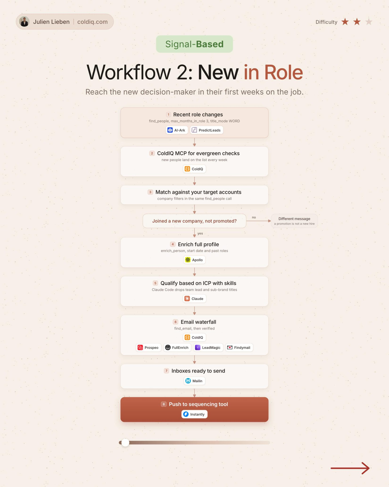

# 2. New in Role

**Signal-based** · ★★☆ Some setup

## The signal

Someone joins a target account in a buying role.

## The steps

1. Check role changes every week
2. Match them against your target accounts
3. Keep people who joined a new company, not internal promotions
4. Qualify with Claude, then run the email waterfall

## The tools

ColdIQ, PredictLeads, Claude, Prospeo, FullEnrich

---

**Run this playbook in Claude Code.** Connect the ColdIQ MCP and ask for it in plain English. [Get your ColdIQ access](https://login.coldiq.com/sign-up?utm_source=github&utm_medium=repo&utm_campaign=master-ai-for-gtm)
