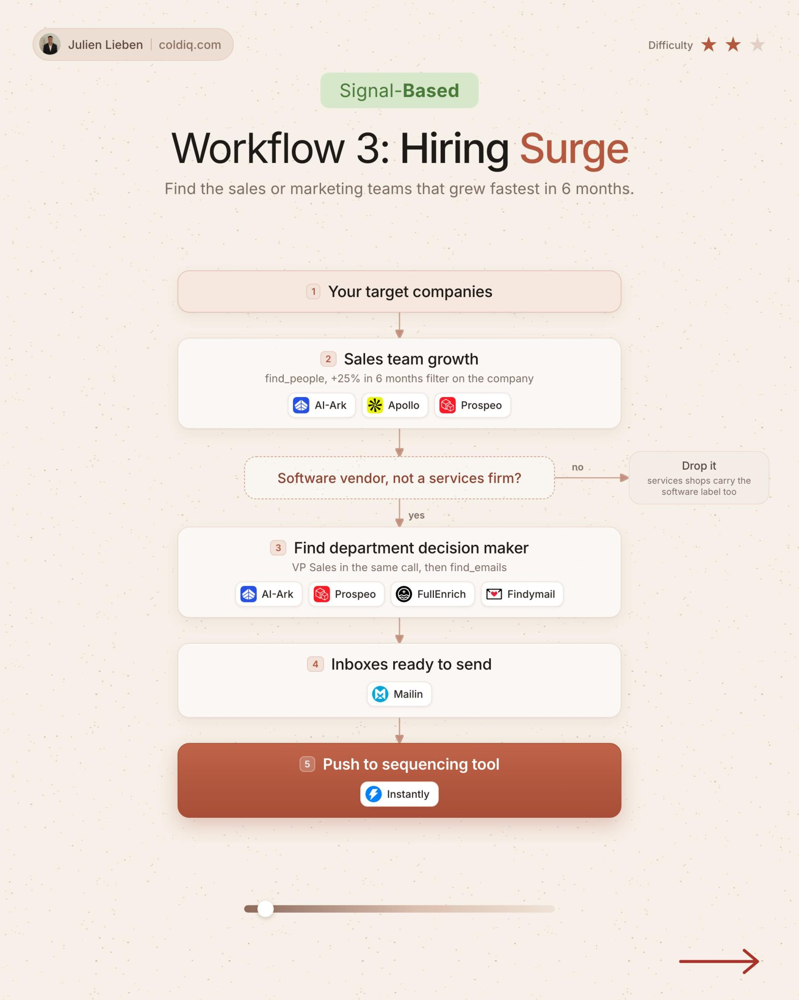

# 3. Hiring Surge

**Signal-based** · ★★☆ Some setup

## The signal

The sales team grew more than 25% in 6 months.

## The steps

1. Pull headcount growth by department
2. Keep software vendors only
3. Find the department decision maker
4. Send while the team is still growing

## The tools

ColdIQ, Prospeo, FullEnrich, Instantly

---

**Run this playbook in Claude Code.** Connect the ColdIQ MCP and ask for it in plain English. [Get your ColdIQ access](https://login.coldiq.com/sign-up?utm_source=github&utm_medium=repo&utm_campaign=master-ai-for-gtm)
