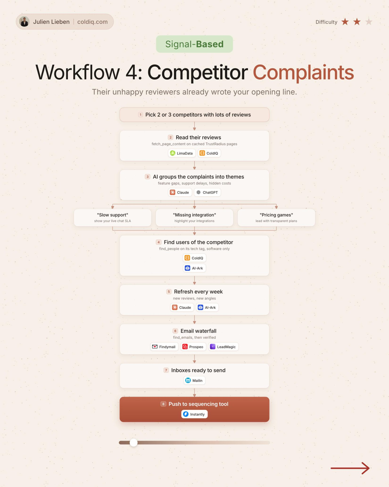

# 4. Competitor Complaints

**Signal-based** · ★★☆ Some setup

## The signal

Users of a competitor complain in public reviews.

## The steps

1. Pick 2 or 3 competitors with lots of reviews
2. Let AI group the complaints into themes
3. Find people at companies using that competitor
4. Write from the theme, refresh every week

## The tools

ColdIQ, Claude, Prospeo, Instantly

---

**Run this playbook in Claude Code.** Connect the ColdIQ MCP and ask for it in plain English. [Get your ColdIQ access](https://login.coldiq.com/sign-up?utm_source=github&utm_medium=repo&utm_campaign=master-ai-for-gtm)
