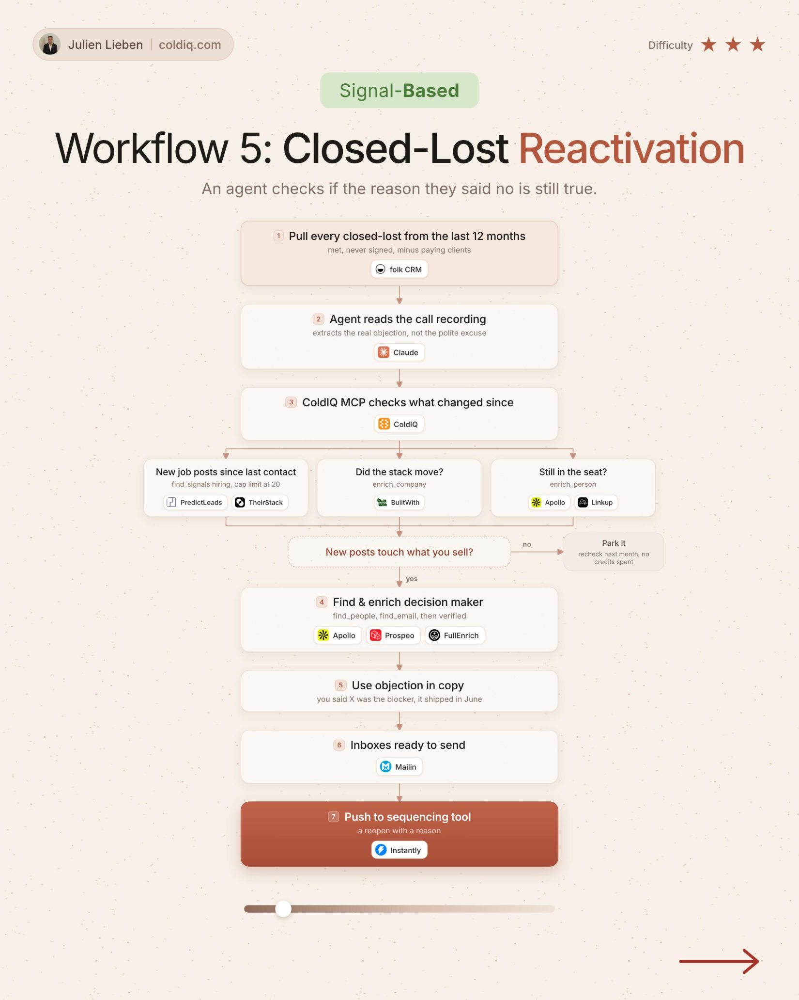

# 5. Closed-Lost Reactivation

**Signal-based** · ★★★ Advanced

## The signal

A deal you lost in the last 12 months shows a new signal.

## The steps

1. Let Claude read the call recording for the real objection
2. Check what changed: new job posts, stack, still in seat
3. Keep only accounts where the change touches what you sell
4. Use the objection in the copy

## The tools

folk, Claude, ColdIQ, PredictLeads, Prospeo

---

**Run this playbook in Claude Code.** Connect the ColdIQ MCP and ask for it in plain English. [Get your ColdIQ access](https://login.coldiq.com/sign-up?utm_source=github&utm_medium=repo&utm_campaign=master-ai-for-gtm)
