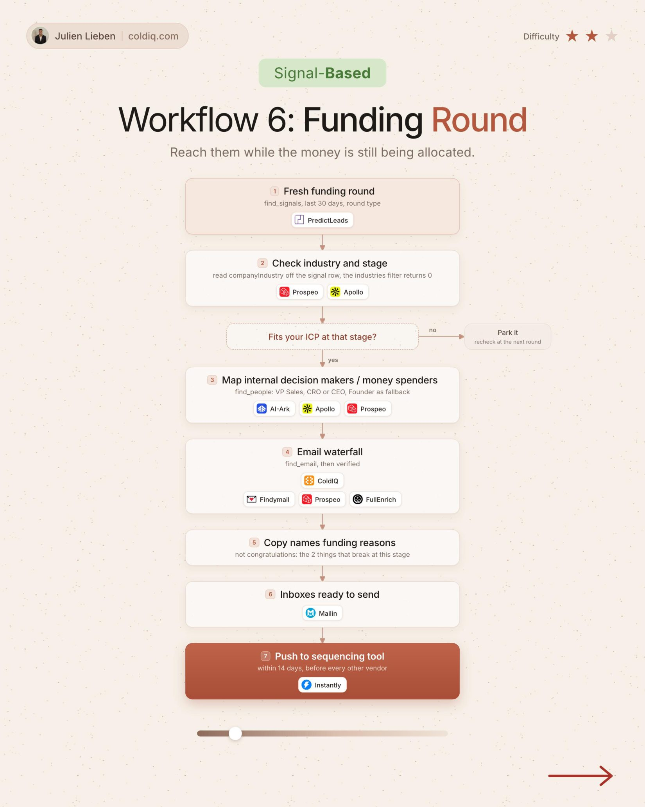

# 6. Funding Round

**Signal-based** · ★★☆ Some setup

## The signal

A fresh funding round is announced.

## The steps

1. Check industry and stage
2. Keep it if your ICP fits at that stage
3. Map the decision makers
4. Name why they raised, and send within 14 days

## The tools

PredictLeads, ColdIQ, Prospeo, FullEnrich, Instantly

---

**Run this playbook in Claude Code.** Connect the ColdIQ MCP and ask for it in plain English. [Get your ColdIQ access](https://login.coldiq.com/sign-up?utm_source=github&utm_medium=repo&utm_campaign=master-ai-for-gtm)
