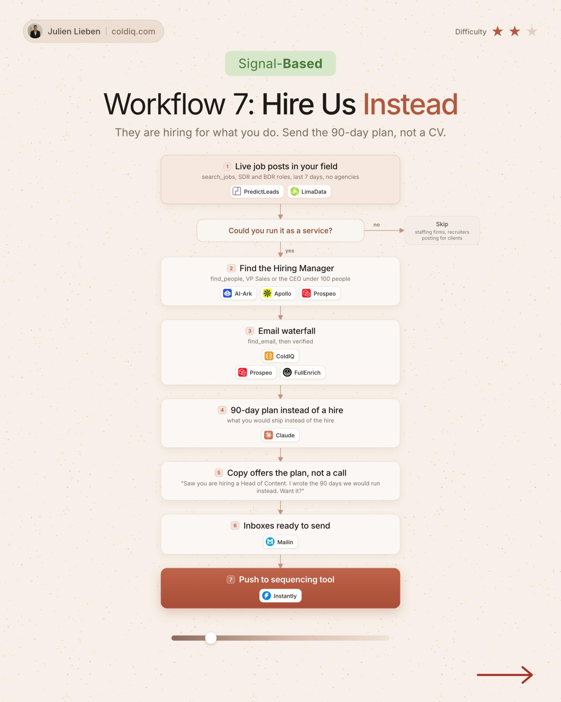

# 7. Hire Us Instead

**Signal-based** · ★★☆ Some setup

## The signal

A live job post in your field (SDR, BDR) from the last 7 days.

## The steps

1. Keep roles you could run as a service
2. Find the hiring manager
3. Offer a 90-day plan instead of a hire

## The tools

PredictLeads, ColdIQ, Claude, Prospeo

---

**Run this playbook in Claude Code.** Connect the ColdIQ MCP and ask for it in plain English. [Get your ColdIQ access](https://login.coldiq.com/sign-up?utm_source=github&utm_medium=repo&utm_campaign=master-ai-for-gtm)
