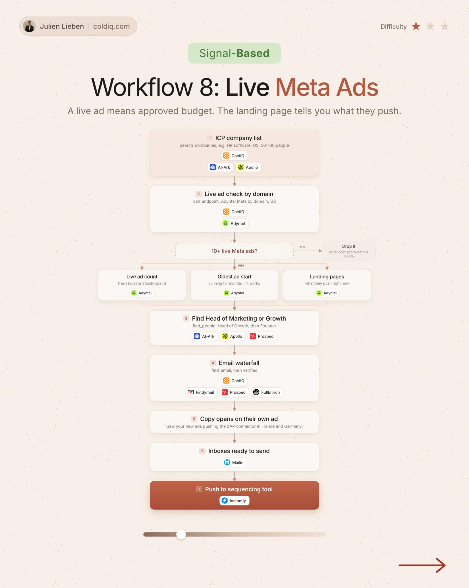

# 8. Live Meta Ads

**Signal-based** · ★☆☆ Quick win

## The signal

An ICP account runs 10+ live Meta ads.

## The steps

1. Run a live ad check on your ICP list
2. Look at ad count, oldest ad and landing pages
3. Find the Head of Marketing or Growth
4. Open on their own ad

## The tools

ColdIQ, Adyntel, Prospeo, FullEnrich

---

**Run this playbook in Claude Code.** Connect the ColdIQ MCP and ask for it in plain English. [Get your ColdIQ access](https://login.coldiq.com/sign-up?utm_source=github&utm_medium=repo&utm_campaign=master-ai-for-gtm)
