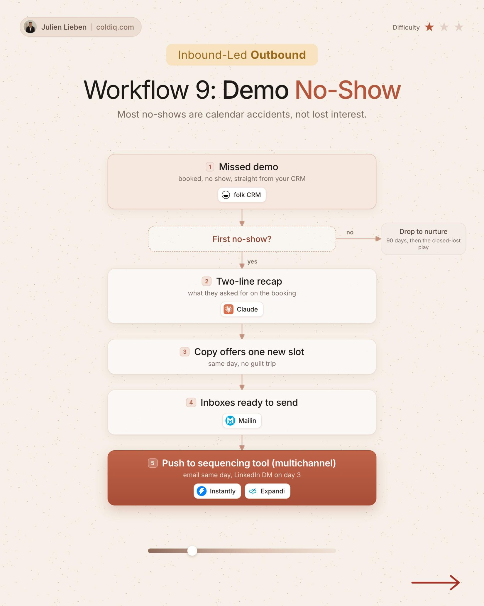

# 9. Demo No-Show

**Inbound-led outbound** · ★☆☆ Quick win

## The signal

A prospect misses the demo.

## The steps

1. Claude writes a two-line recap of what they booked for
2. Offer one new slot

## The tools

folk, Claude, Instantly, Expandi

---

**Run this playbook in Claude Code.** Connect the ColdIQ MCP and ask for it in plain English. [Get your ColdIQ access](https://login.coldiq.com/sign-up?utm_source=github&utm_medium=repo&utm_campaign=master-ai-for-gtm)
