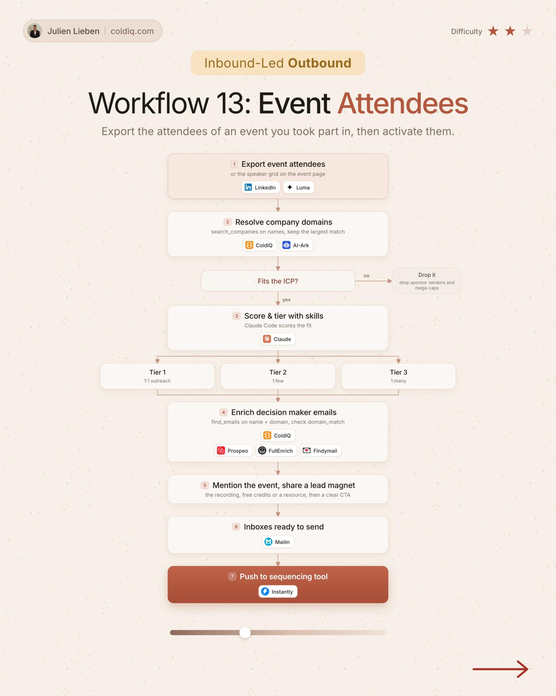

# 13. Event Attendees

**Inbound-led outbound** · ★★☆ Some setup

## The signal

Someone attended an event.

## The steps

1. Export attendees and resolve company domains
2. Score and tier with Claude
3. Enrich decision makers
4. Mention the event and share a lead magnet

## The tools

ColdIQ, Claude, Prospeo, FullEnrich

---

**Run this playbook in Claude Code.** Connect the ColdIQ MCP and ask for it in plain English. [Get your ColdIQ access](https://login.coldiq.com/sign-up?utm_source=github&utm_medium=repo&utm_campaign=master-ai-for-gtm)
