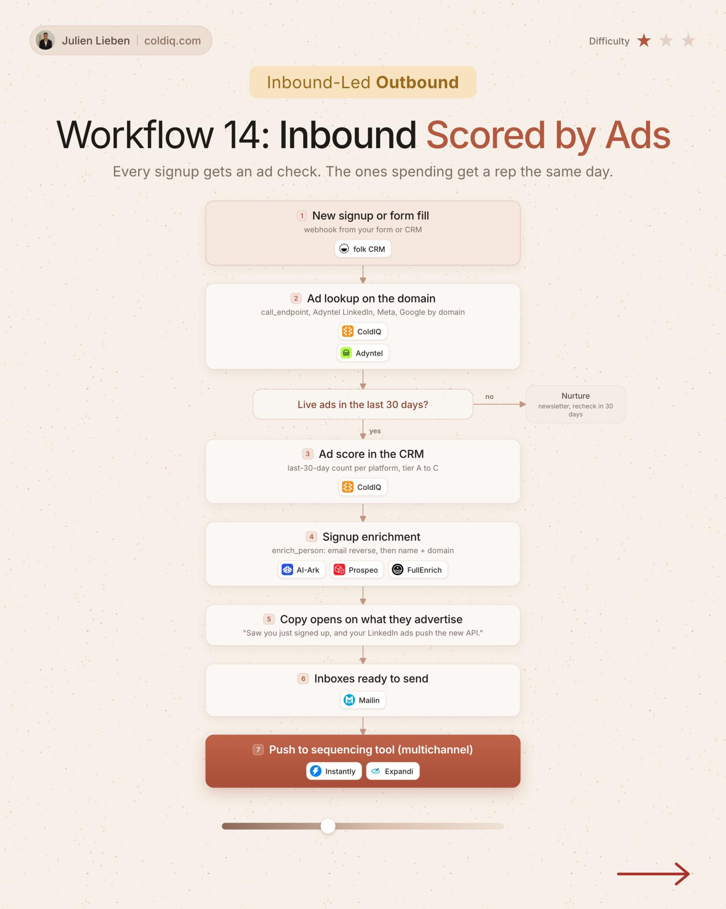

# 14. Inbound Scored by Ads

**Inbound-led outbound** · ★☆☆ Quick win

## The signal

A new signup or form fill.

## The steps

1. Look up ads on the domain: LinkedIn, Meta, Google
2. Keep accounts with live ads in the last 30 days
3. Write an ad score to the CRM
4. Open on what they advertise

## The tools

folk, ColdIQ, Adyntel, Prospeo

---

**Run this playbook in Claude Code.** Connect the ColdIQ MCP and ask for it in plain English. [Get your ColdIQ access](https://login.coldiq.com/sign-up?utm_source=github&utm_medium=repo&utm_campaign=master-ai-for-gtm)
