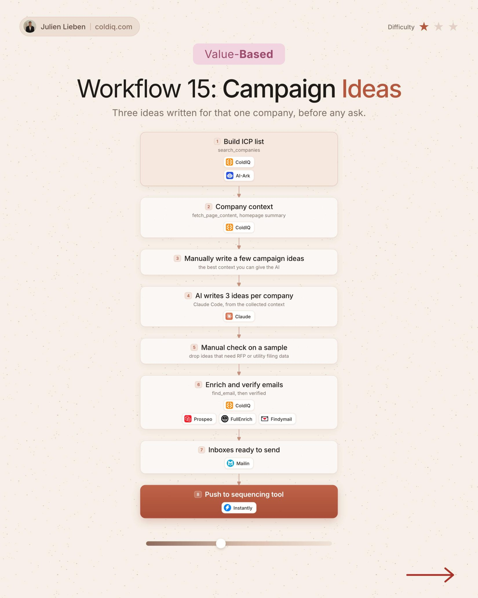

# 15. Campaign Ideas

**Value-based** · ★☆☆ Quick win

## The signal

Any account on your ICP list.

## The steps

1. Summarize the homepage
2. AI writes 3 campaign ideas for that company
3. Check a sample by hand, then send the ideas

## The tools

ColdIQ, Claude, Prospeo

---

**Run this playbook in Claude Code.** Connect the ColdIQ MCP and ask for it in plain English. [Get your ColdIQ access](https://login.coldiq.com/sign-up?utm_source=github&utm_medium=repo&utm_campaign=master-ai-for-gtm)
