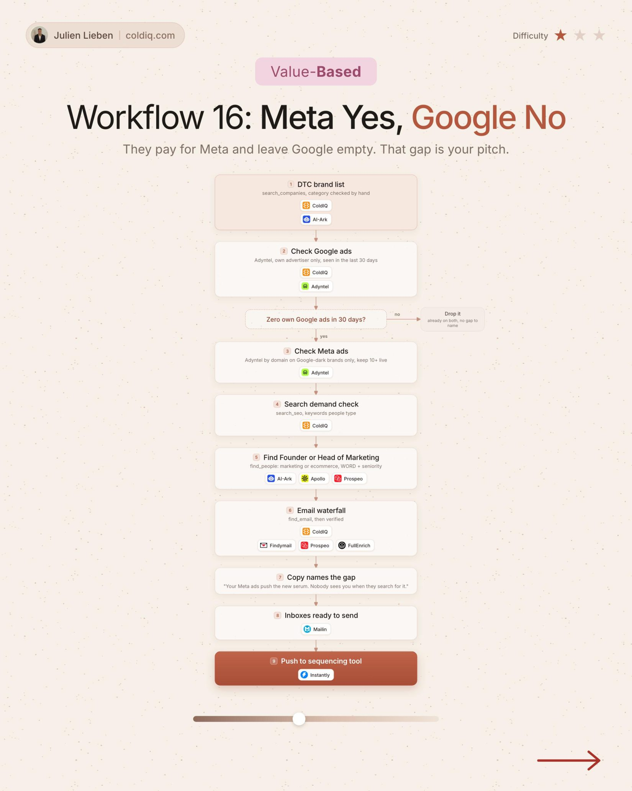

# 16. Meta Yes, Google No

**Value-based** · ★☆☆ Quick win

## The signal

A DTC brand runs Meta ads but zero Google ads in 30 days.

## The steps

1. Check search demand for what they sell
2. Find the founder or Head of Marketing
3. Name the gap

## The tools

ColdIQ, Adyntel, Prospeo

---

**Run this playbook in Claude Code.** Connect the ColdIQ MCP and ask for it in plain English. [Get your ColdIQ access](https://login.coldiq.com/sign-up?utm_source=github&utm_medium=repo&utm_campaign=master-ai-for-gtm)
