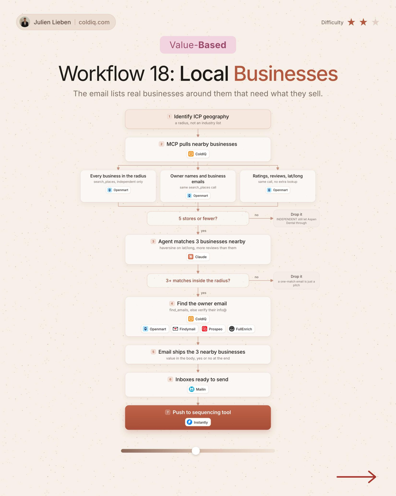

# 18. Local Businesses

**Value-based** · ★★☆ Some setup

## The signal

A local business with 5 stores or fewer.

## The steps

1. Pull businesses near your ICP geography
2. An agent matches 3 nearby businesses
3. Send the 3 businesses in the email

## The tools

ColdIQ, Openmart, Claude, Prospeo

---

**Run this playbook in Claude Code.** Connect the ColdIQ MCP and ask for it in plain English. [Get your ColdIQ access](https://login.coldiq.com/sign-up?utm_source=github&utm_medium=repo&utm_campaign=master-ai-for-gtm)
