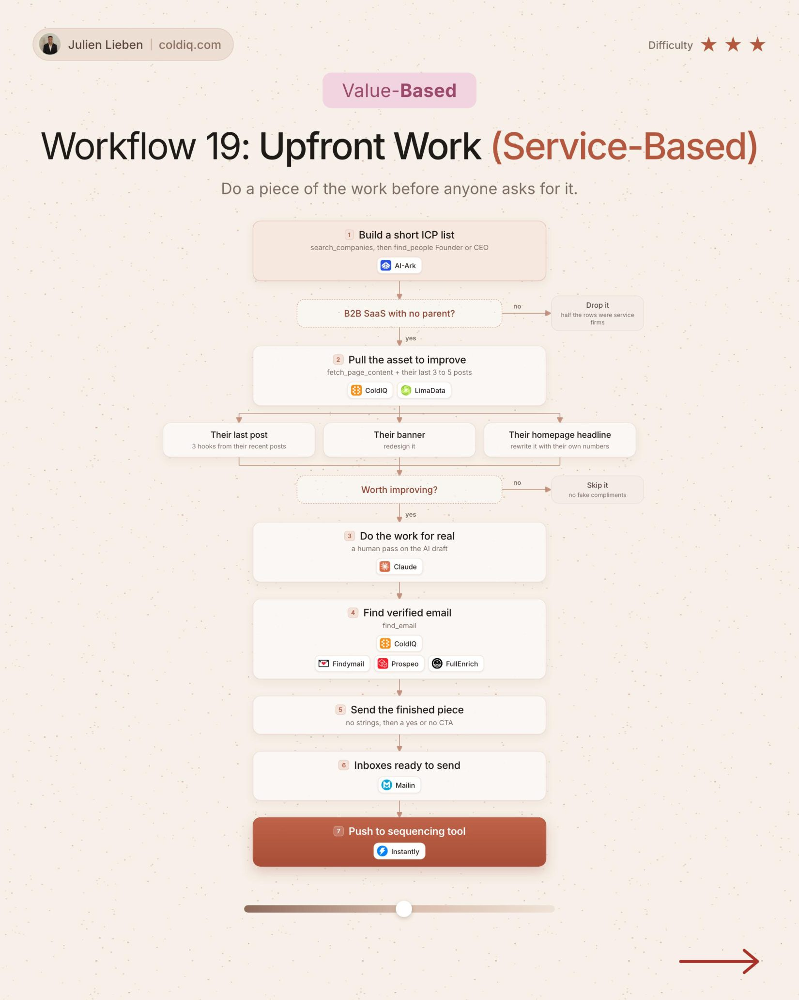

# 19. Upfront Work (Service-Based)

**Value-based** · ★★★ Advanced

## The signal

A B2B SaaS that is not part of a group.

## The steps

1. Pick one asset to improve: last post, banner, homepage headline
2. Do the work
3. Send the finished piece

## The tools

ColdIQ, Claude, Prospeo

---

**Run this playbook in Claude Code.** Connect the ColdIQ MCP and ask for it in plain English. [Get your ColdIQ access](https://login.coldiq.com/sign-up?utm_source=github&utm_medium=repo&utm_campaign=master-ai-for-gtm)
