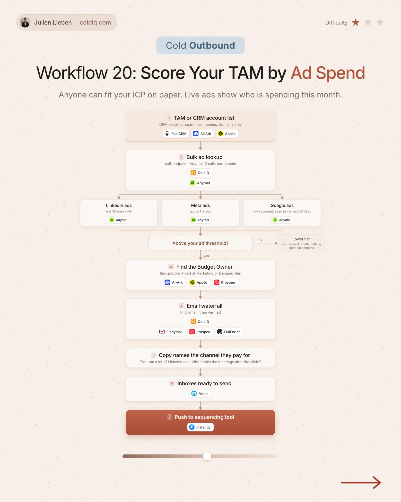

# 20. Score Your TAM by Ad Spend

**Cold outbound** · ★☆☆ Quick win

## The signal

Your whole TAM.

## The steps

1. Bulk ad lookup on LinkedIn, Meta and Google
2. Keep accounts above an ad threshold
3. Find the budget owner

## The tools

folk, ColdIQ, Adyntel, Prospeo

---

**Run this playbook in Claude Code.** Connect the ColdIQ MCP and ask for it in plain English. [Get your ColdIQ access](https://login.coldiq.com/sign-up?utm_source=github&utm_medium=repo&utm_campaign=master-ai-for-gtm)
