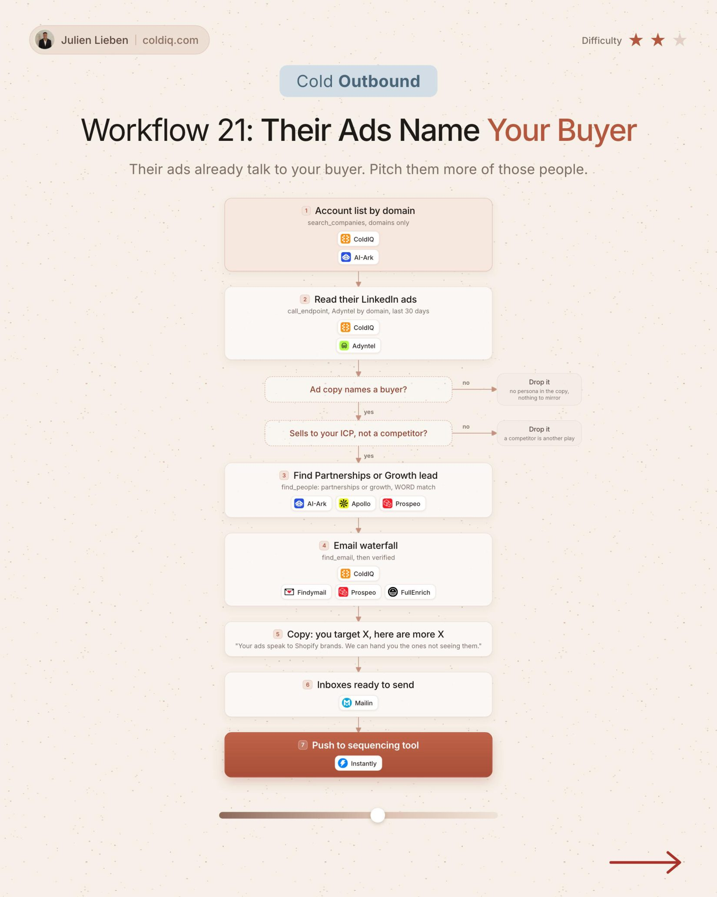

# 21. Their Ads Name Your Buyer

**Cold outbound** · ★★☆ Some setup

## The signal

Their LinkedIn ads from the last 30 days name a buyer you also sell to.

## The steps

1. Read their ads
2. Keep companies that sell to your ICP and are not competitors
3. Find the Partnerships or Growth lead

## The tools

ColdIQ, Adyntel, Prospeo

---

**Run this playbook in Claude Code.** Connect the ColdIQ MCP and ask for it in plain English. [Get your ColdIQ access](https://login.coldiq.com/sign-up?utm_source=github&utm_medium=repo&utm_campaign=master-ai-for-gtm)
