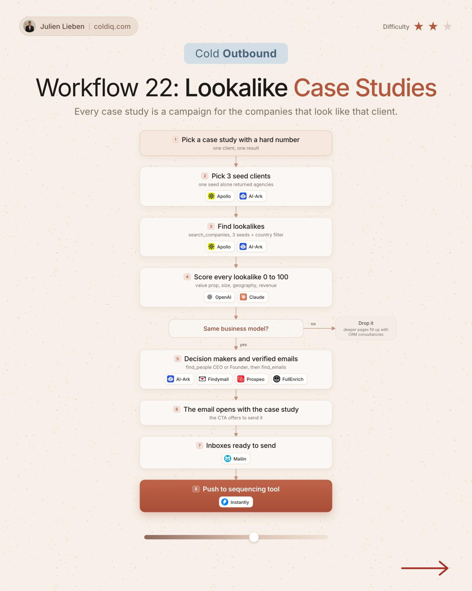

# 22. Lookalike Case Studies

**Cold outbound** · ★★☆ Some setup

## The signal

One case study and 3 seed clients.

## The steps

1. Find lookalikes of the seed clients
2. Score every lookalike 0 to 100
3. Keep the same business model

## The tools

ColdIQ, Claude, Prospeo

---

**Run this playbook in Claude Code.** Connect the ColdIQ MCP and ask for it in plain English. [Get your ColdIQ access](https://login.coldiq.com/sign-up?utm_source=github&utm_medium=repo&utm_campaign=master-ai-for-gtm)
