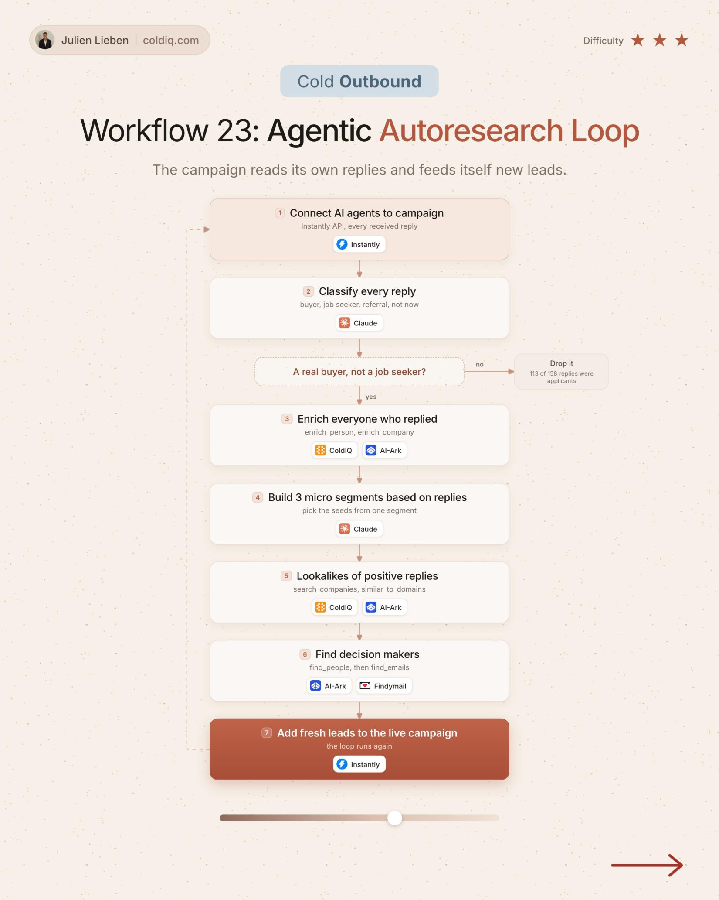

# 23. Agentic Autoresearch Loop

**Cold outbound** · ★★★ Advanced

## The signal

Replies come in on a live campaign.

## The steps

1. Classify every reply
2. Enrich the real buyers
3. Claude builds 3 micro segments
4. Find lookalikes of positive replies and feed them back into the campaign

## The tools

Instantly, Claude, ColdIQ

---

**Run this playbook in Claude Code.** Connect the ColdIQ MCP and ask for it in plain English. [Get your ColdIQ access](https://login.coldiq.com/sign-up?utm_source=github&utm_medium=repo&utm_campaign=master-ai-for-gtm)
