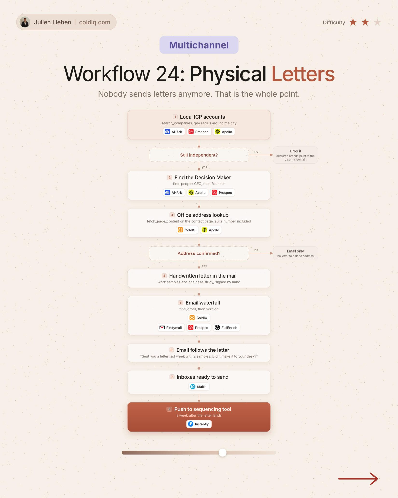

# 24. Physical Letters

**Multichannel** · ★★☆ Some setup

## The signal

A local ICP account that is still independent.

## The steps

1. Find the decision maker
2. Look up the office address
3. Send a handwritten letter, then an email

## The tools

ColdIQ, Prospeo

---

**Run this playbook in Claude Code.** Connect the ColdIQ MCP and ask for it in plain English. [Get your ColdIQ access](https://login.coldiq.com/sign-up?utm_source=github&utm_medium=repo&utm_campaign=master-ai-for-gtm)
