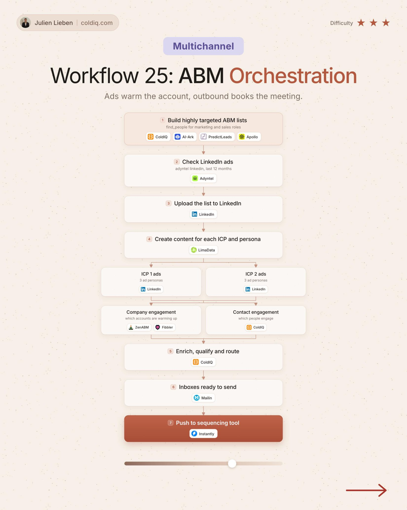

# 25. ABM Orchestration

**Multichannel** · ★★★ Advanced

## The signal

A targeted ABM list.

## The steps

1. Check their LinkedIn ads from the last 12 months
2. Upload the list to LinkedIn and run ads per ICP
3. Track company and contact engagement
4. Enrich and route to outbound

## The tools

ColdIQ, PredictLeads, Adyntel, LinkedIn

---

**Run this playbook in Claude Code.** Connect the ColdIQ MCP and ask for it in plain English. [Get your ColdIQ access](https://login.coldiq.com/sign-up?utm_source=github&utm_medium=repo&utm_campaign=master-ai-for-gtm)
