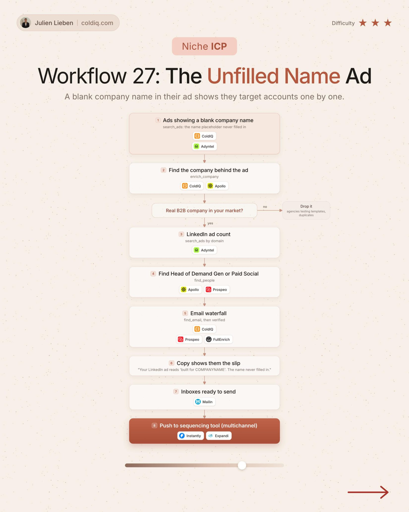

# 27. The Unfilled Name Ad

**Niche ICP** · ★★★ Advanced

## The signal

An ad shows a blank company-name placeholder.

## The steps

1. Find the company behind the ad
2. Keep real B2B companies in your market
3. Get the LinkedIn ad count
4. Find the Head of Demand Gen and show them the slip

## The tools

ColdIQ, Adyntel, Prospeo

---

**Run this playbook in Claude Code.** Connect the ColdIQ MCP and ask for it in plain English. [Get your ColdIQ access](https://login.coldiq.com/sign-up?utm_source=github&utm_medium=repo&utm_campaign=master-ai-for-gtm)
