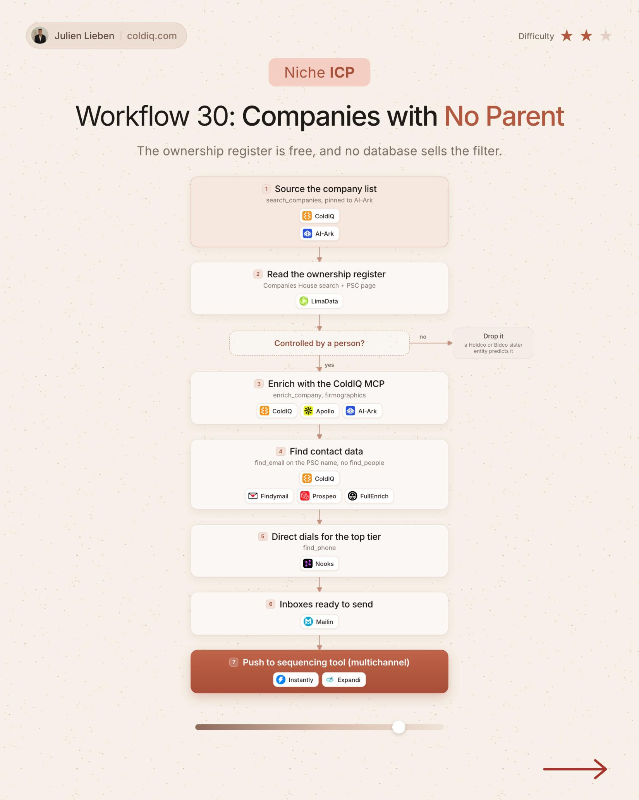

# 30. Companies with No Parent

**Niche ICP** · ★★☆ Some setup

## The signal

The ownership register shows a company controlled by a person.

## The steps

1. Keep companies with a person in control
2. Enrich the owner

## The tools

ColdIQ, Prospeo, FullEnrich

---

**Run this playbook in Claude Code.** Connect the ColdIQ MCP and ask for it in plain English. [Get your ColdIQ access](https://login.coldiq.com/sign-up?utm_source=github&utm_medium=repo&utm_campaign=master-ai-for-gtm)
