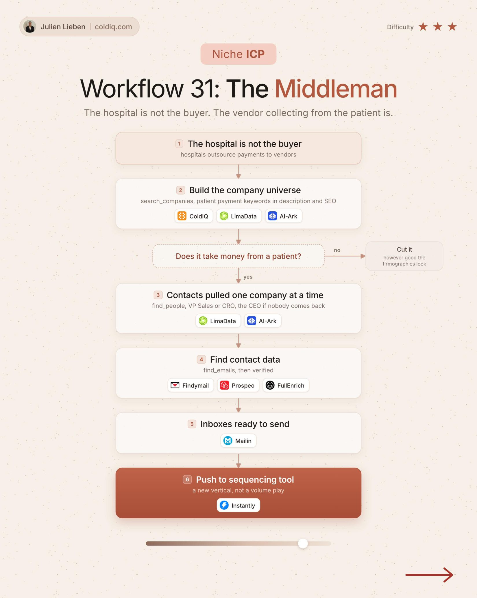

# 31. The Middleman

**Niche ICP** · ★★★ Advanced

## The signal

Vendors that hospitals outsource patient payments to.

## The steps

1. Build the company universe
2. Keep those that take money from a patient
3. Pull contacts

## The tools

ColdIQ, Prospeo, FullEnrich

---

**Run this playbook in Claude Code.** Connect the ColdIQ MCP and ask for it in plain English. [Get your ColdIQ access](https://login.coldiq.com/sign-up?utm_source=github&utm_medium=repo&utm_campaign=master-ai-for-gtm)
