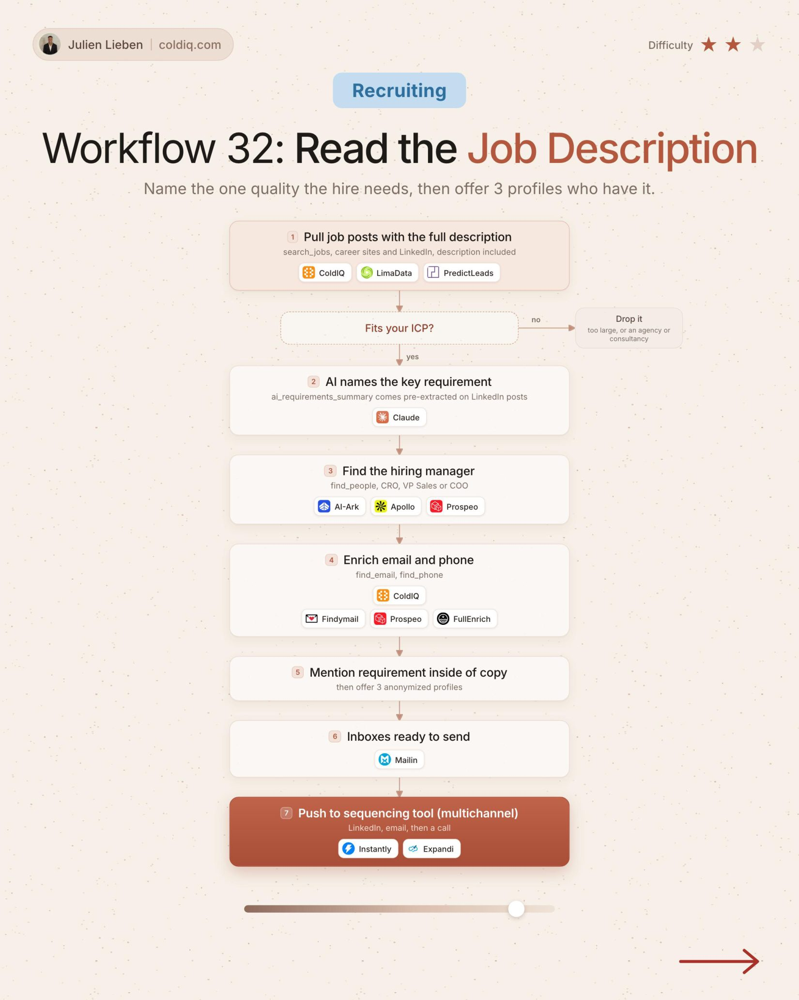

# 32. Read the Job Description

**Recruiting** · ★★☆ Some setup

## The signal

A job post with its full description.

## The steps

1. AI names the key requirement
2. Find the hiring manager
3. Mention the requirement and offer 3 profiles

## The tools

ColdIQ, PredictLeads, Claude, Prospeo

---

**Run this playbook in Claude Code.** Connect the ColdIQ MCP and ask for it in plain English. [Get your ColdIQ access](https://login.coldiq.com/sign-up?utm_source=github&utm_medium=repo&utm_campaign=master-ai-for-gtm)
