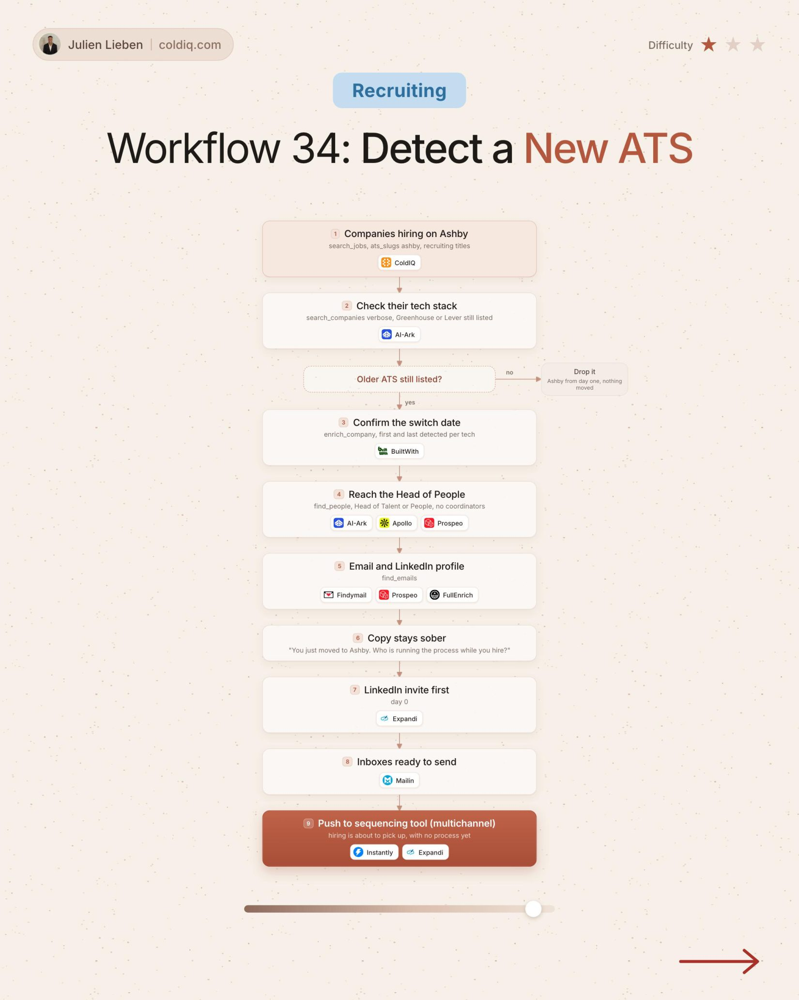

# 34. Detect a New ATS

**Recruiting** · ★☆☆ Quick win

## The signal

A company hires on a new ATS while the old one is still listed.

## The steps

1. Confirm the switch date
2. Reach the Head of People

## The tools

ColdIQ, Prospeo, Expandi

---

**Run this playbook in Claude Code.** Connect the ColdIQ MCP and ask for it in plain English. [Get your ColdIQ access](https://login.coldiq.com/sign-up?utm_source=github&utm_medium=repo&utm_campaign=master-ai-for-gtm)
