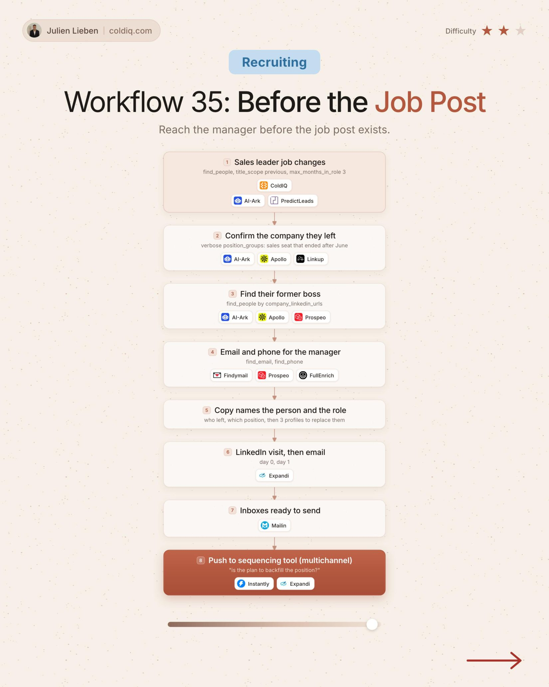

# 35. Before the Job Post

**Recruiting** · ★★☆ Some setup

## The signal

A sales leader just left a company.

## The steps

1. Confirm the company they left
2. Find their former boss
3. Name the person and the role before the job is posted

## The tools

ColdIQ, PredictLeads, Prospeo, Expandi

---

**Run this playbook in Claude Code.** Connect the ColdIQ MCP and ask for it in plain English. [Get your ColdIQ access](https://login.coldiq.com/sign-up?utm_source=github&utm_medium=repo&utm_campaign=master-ai-for-gtm)
