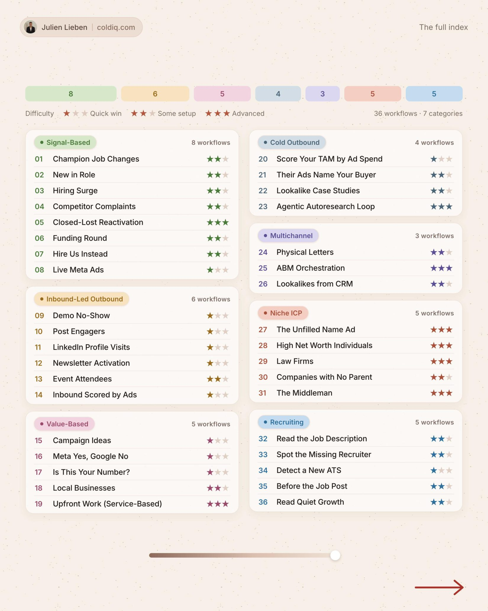

# 36 playbooks

Our favorite campaigns to run inside the terminal, from the signal to the booked meeting.

| # | Playbook | Category | Difficulty |
|---|---|---|---|
| 1 | [Champion Job Changes](01-champion-job-changes.md) | Signal-based | ★★☆ |
| 2 | [New in Role](02-new-in-role.md) | Signal-based | ★★☆ |
| 3 | [Hiring Surge](03-hiring-surge.md) | Signal-based | ★★☆ |
| 4 | [Competitor Complaints](04-competitor-complaints.md) | Signal-based | ★★☆ |
| 5 | [Closed-Lost Reactivation](05-closed-lost-reactivation.md) | Signal-based | ★★★ |
| 6 | [Funding Round](06-funding-round.md) | Signal-based | ★★☆ |
| 7 | [Hire Us Instead](07-hire-us-instead.md) | Signal-based | ★★☆ |
| 8 | [Live Meta Ads](08-live-meta-ads.md) | Signal-based | ★☆☆ |
| 9 | [Demo No-Show](09-demo-no-show.md) | Inbound-led outbound | ★☆☆ |
| 10 | [Post Engagers](10-post-engagers.md) | Inbound-led outbound | ★☆☆ |
| 11 | [LinkedIn Profile Visits](11-linkedin-profile-visits.md) | Inbound-led outbound | ★☆☆ |
| 12 | [Newsletter Activation](12-newsletter-activation.md) | Inbound-led outbound | ★☆☆ |
| 13 | [Event Attendees](13-event-attendees.md) | Inbound-led outbound | ★★☆ |
| 14 | [Inbound Scored by Ads](14-inbound-scored-by-ads.md) | Inbound-led outbound | ★☆☆ |
| 15 | [Campaign Ideas](15-campaign-ideas.md) | Value-based | ★☆☆ |
| 16 | [Meta Yes, Google No](16-meta-yes-google-no.md) | Value-based | ★☆☆ |
| 17 | [Is This Your Number?](17-is-this-your-number.md) | Value-based | ★☆☆ |
| 18 | [Local Businesses](18-local-businesses.md) | Value-based | ★★☆ |
| 19 | [Upfront Work (Service-Based)](19-upfront-work-service-based.md) | Value-based | ★★★ |
| 20 | [Score Your TAM by Ad Spend](20-score-your-tam-by-ad-spend.md) | Cold outbound | ★☆☆ |
| 21 | [Their Ads Name Your Buyer](21-their-ads-name-your-buyer.md) | Cold outbound | ★★☆ |
| 22 | [Lookalike Case Studies](22-lookalike-case-studies.md) | Cold outbound | ★★☆ |
| 23 | [Agentic Autoresearch Loop](23-agentic-autoresearch-loop.md) | Cold outbound | ★★★ |
| 24 | [Physical Letters](24-physical-letters.md) | Multichannel | ★★☆ |
| 25 | [ABM Orchestration](25-abm-orchestration.md) | Multichannel | ★★★ |
| 26 | [Lookalikes from CRM](26-lookalikes-from-crm.md) | Multichannel | ★★☆ |
| 27 | [The Unfilled Name Ad](27-the-unfilled-name-ad.md) | Niche ICP | ★★★ |
| 28 | [High Net Worth Individuals](28-high-net-worth-individuals.md) | Niche ICP | ★★★ |
| 29 | [Law Firms](29-law-firms.md) | Niche ICP | ★★★ |
| 30 | [Companies with No Parent](30-companies-with-no-parent.md) | Niche ICP | ★★☆ |
| 31 | [The Middleman](31-the-middleman.md) | Niche ICP | ★★★ |
| 32 | [Read the Job Description](32-read-the-job-description.md) | Recruiting | ★★☆ |
| 33 | [Spot the Missing Recruiter](33-spot-the-missing-recruiter.md) | Recruiting | ★★☆ |
| 34 | [Detect a New ATS](34-detect-a-new-ats.md) | Recruiting | ★☆☆ |
| 35 | [Before the Job Post](35-before-the-job-post.md) | Recruiting | ★★☆ |
| 36 | [Read Quiet Growth](36-read-quiet-growth.md) | Recruiting | ★★☆ |

[Run them with ColdIQ](https://login.coldiq.com/sign-up?utm_source=github&utm_medium=repo&utm_campaign=master-ai-for-gtm)
